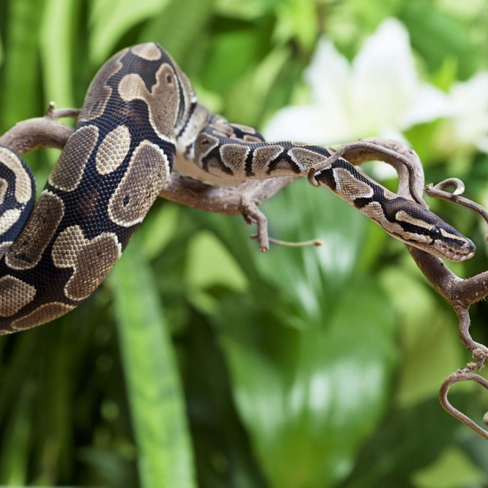
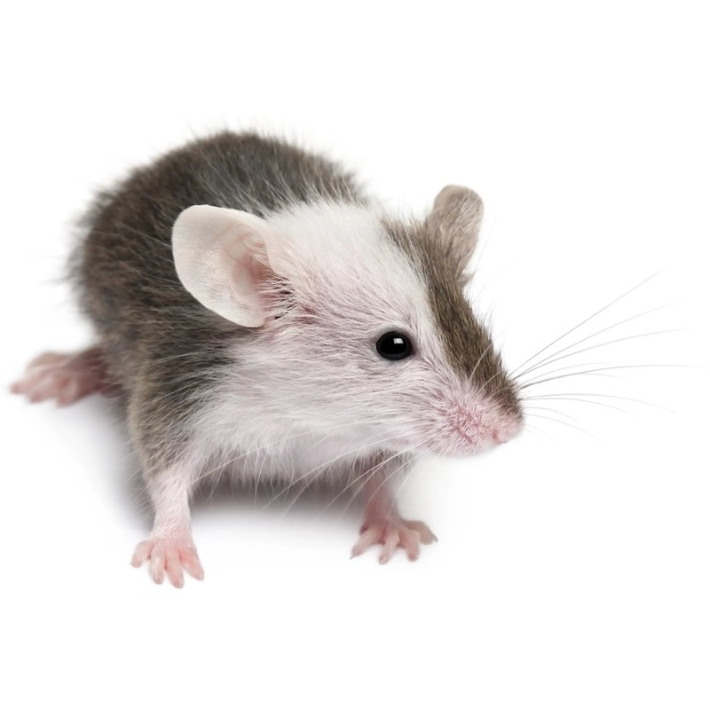

# Royal Python Not Eating? Causes and Fixes

A royal python not eating is one of the most common worries for UK snake keepers, and it's usually down to the set-up, a coming shed or simple stress rather than illness. Royal pythons (*Python regius*, called ball pythons in America) are famous for skipping meals. This guide walks through the checks to make, using the [Northampton Reptile Centre royal python care sheet](https://www.reptilecentre.com/pages/info-royal-python-care-sheet) and the RSPCA's royal python advice.

*A royal python in a furnished set-up. Cover and the right heat are the first things to check.*

## 1. Is it actually a problem?

Not always. The RSPCA notes that pythons have a low energy output, so they may not feed as often as other snakes. Adults also don't need weekly meals: the shop's care sheet feeds adults **once every two weeks**, because weekly feeding can make them overweight. A missed meal or two from a healthy adult that's holding its weight isn't an emergency.

It's more of a concern if:

* it's a hatchling or young snake that's stopped feeding
* the snake is visibly losing weight, or the scales look wrinkled or the spine stands out
* there are other signs such as diarrhoea, mites, a whistling sound when breathing, or gasping with the head raised
* a snake that fed well has **suddenly** stopped

In any of those cases, see a reptile specialist vet. Weighing your snake regularly (the RSPCA recommends it) is the easiest way to know whether a fast matters.

## 2. Quick checklist: why your royal python won't eat

| Possible cause | What to check | What to do |
| --- | --- | --- |
| Temperatures too low | About 31°C (88°F) over one third of the vivarium, with the cool side around 29°C (85°F), per the care sheet | Use a guarded ceramic heat lamp on a pulse thermostat, and check both ends with a [reptile thermometer](https://www.reptilecentre.com/collections/thermometers) |
| Not enough cover | Royals get stressed in large, open, bare spaces (RSPCA) | Add snug [hides](https://www.reptilecentre.com/collections/reptile-hides) at both the warm and cool ends |
| Coming up to a shed | Dull skin or cloudy, blue-grey eyes | Offer a humid hide with damp moss and try again after the shed |
| New to the home | Moved in within the last week or two | Leave it alone and don't handle it for the first week |
| Prey size or condition | Prey should be slightly wider than the widest part of the snake's body | Thaw frozen prey fully and offer it with tongs inside the vivarium |
| Handling too soon | Being handled within 48 hours of a meal | Wait 48 hours after feeding before handling |
| Possible illness | Weight loss, diarrhoea, mites or breathing noises | Book a reptile vet |

## 3. Check the heat first

Snakes are ectothermic, so a cold snake won't digest food properly and often won't feed at all. The care sheet aims for around **31°C** on the basking side and **29°C** on the cool side. That heat comes from a guarded ceramic heat lamp on one side of the ceiling, controlled by a pulse thermostat. Ceramics give off no light, so they can run day and night while the lights go off for a clear day–night cycle.

Don't trust the thermostat dial alone. A dial thermometer at each end will do, but a digital probe thermometer is more accurate. Keep the vivarium away from draughts, radiators and direct sun, as the RSPCA advises.

## 4. Give it somewhere to hide

In the wild royals spend the hot part of the day in burrows and termite mounds. In a vivarium, a shy royal that can't hide at a comfortable temperature may refuse food. The RSPCA recommends several hides at both ends, each big enough to get into but small enough that the coiled snake touches the sides. The shop also adds extra décor for young snakes in a full-size enclosure, so they feel secure.

## 5. Shedding, season and breeding

* **Shedding:** the RSPCA notes a snake may refuse food when it's about to shed. The care sheet recommends a fully enclosed hide with wet moss, rather than raising humidity across the whole vivarium. Most snakes feed again soon after a clean shed.
* **Cooler months:** many keepers find that adult royals, especially males, eat less or fast for a while in winter and the breeding season. A healthy adult holding its weight can often ride this out, but weigh it and ask a vet if it drops weight.
* **Females with eggs:** a gravid female will often stop eating. If you've kept a male and female together, the care sheet's breeding section explains what to prepare.

## 6. Getting a fussy royal python to feed

*Frozen-thawed mice are the staple food for royal pythons.*

1. **Fix the set-up first.** Check temperatures and hides before changing anything else.
2. **Thaw prey properly.** The care sheet feeds frozen-thawed food. Defrost it fully so it isn't cold in the middle. Browse [frozen mice](https://www.reptilecentre.com/collections/frozen-mice) by size.
3. **Get the size right.** Offer prey slightly wider than the widest part of the body. Hatchlings start on pinkies and move up until the adult takes large mice or jumbos.
4. **Use tongs and keep it calm.** Offer the prey inside the vivarium in the evening, then leave the snake undisturbed. If it isn't taken, remove it and try again in about a week rather than every day.
5. **Try an alternative only as a last resort.** The care sheet says gerbils, hamsters, multimammate mice or chicks could be used if a royal won't take anything else, but they aren't as nutritious as mice.

> **Buying a royal?** The RSPCA advises finding out how a snake has been feeding before you take it on, and avoiding one that hasn't been feeding well.

## 7. A set-up that helps them feed

The care sheet recommends a wooden vivarium of at least **3 × 2 × 2 ft**, closer to 4 × 2 × 2 ft for large females, with large vents and sliding glass doors. If you'd rather start with everything matched, the [ball python setup](https://www.reptilecentre.com/products/royal-python-setup) bundles the vivarium with heating and lighting.

## FAQ

**How long can a royal python go without eating?**  
Healthy adults can go weeks, and sometimes longer, without food, which is why weight matters more than days. Young snakes have fewer reserves, so get a hatchling that's stopped feeding checked sooner.

**Should I force-feed my royal python?**  
No. Don't try to force-feed at home. If a snake is losing weight, a reptile vet can find the cause and advise.

**Can I leave a live mouse in with my royal python?**  
The care sheet and the RSPCA both recommend frozen-thawed rodents. Don't leave live prey unattended with a snake, because it can injure it.

**How often should a royal python eat?**  
Hatchlings weekly and adults every two weeks, according to the care sheet. The RSPCA gives every five or six days for young snakes and every seven to 14 days for adults, depending on weight.

## Further reading

* [Royal python care sheet – Northampton Reptile Centre](https://www.reptilecentre.com/pages/info-royal-python-care-sheet)
* [RSPCA: Royal python care](https://www.rspca.org.uk/adviceandwelfare/pets/other/royalpython)
* [About Northampton Reptile Centre](https://www.reptilecentre.com/pages/info-about-us)

General information for UK keepers, not a substitute for advice from a reptile vet.

---

## About Northampton Reptile Centre

Northampton Reptile Centre is a family-run reptile specialist, founded in 1995, selling vivariums, heating, lighting, livefood and frozen food online and in store.

**Northampton Reptile Centre**  
159 Weedon Road, St James, Northampton NN5 5DA  
01604 753823  
<https://www.reptilecentre.com/>